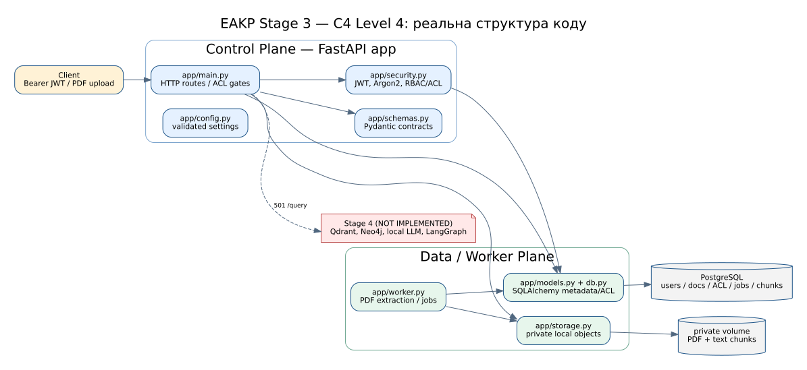

# EAKP · Етап 3 — Працюючий фундамент бекенду

**Редакція:** v0.3 · 16.11.2026 · **Статус: реалізовано код; автоматизовані тести пройдено локально.**

> Реалізовано: локальна автентифікація, PostgreSQL-схема, HTTP API, приймання PDF, об’єктне файлове сховище, черга ingestion, извлечення тексту з PDF, базовий доступ на рівні документів, аудит. **Не реалізовано:** GraphRAG, Qdrant, Neo4j, OCR для сканів, локальна LLM, LangGraph, production-ready air-gap, TLS на вході, SSO, повноцінний Observability, навантажувальний бенчмарк.
>
> Фактично перевірено: `pytest` на SQLite та міграцію Alembic на SQLite. Docker Compose з PostgreSQL **не запускався** в цьому середовищі через відсутність Docker Engine. Тому PostgreSQL/Docker інтеграція підлягає запуску в середовищі користувача.

## 1. Прив’язка до попередніх документів

| Stage 1 / Stage 2 | Реалізація Stage 3 | Стан |
| --- | --- | --- |
| FR-01: authenticated API / JWT | `app/security.py`, `app/main.py` | **Реалізовано**: локальний адміністративний bootstrap + JWT/HS256; корпоративний OIDC — пізніше |
| FR-02: PDF + ACL + job id | POST `/api/v1/documents`, `LocalStorage` | **Реалізовано**: первинне завантаження PDF, UUID, SHA256, owner, job |
| FR-03: text PDF / OCR | `app/worker.py` | **Частково**: текстові PDF → `TEXT_EXTRACTED`; скани → `NEEDS_OCR` |
| FR-04/05/06/07/09: GraphRAG + LLM + LangGraph | POST `/api/v1/query` | **Не реалізовано**: повертає чесний HTTP 501 |
| FR-08: авторитетні ACL з PostgreSQL | `app/security.py`, `AccessGrant`, `acl_epoch` | **Реалізовано** на метаданих / скачуванні; retrieval gate — Stage 4 |
| FR-10 / ADR-0004: jobs in PG | `IngestionJob`, `claim_job()` | **Базово реалізовано**: статуси, спроби, 10-хв. lease; без heartbeat |
| ADR-0006: авторитетний ACL / epoch | `allowed()`, `change_acl()`, group membership epoch | **Базово реалізовано**; конкурентний final gate для LLM — Stage 4 |
| ADR-0007: dual-index publication pointer | `Document.active_index_run_id=NULL` | **Спроєктовано, не реалізовано**; жодний документ не оголошується індексованим |
| ADR-0008: графове походження доказів | `Chunk.version_id/page_number` | **Частково**: provenance тексту; graph edges — Stage 4 |

## 2. Фактична структура коду (C4 Level 4)

**Control Plane**: `main.py` (FastAPI); `security.py` (JWT/RBAC/ACL); `schemas.py` (контракти); `config.py` (конфігурація). **Data Plane**: `db.py`/`models.py` (PostgreSQL/SQLite); `storage.py` (документи і текстові чанки); `worker.py` (вилучення PDF), зі збереженням даних у Postgres і локальному томі. `alembic` керує початковою міграцією. 

Важливе відхилення від цільової архітектури Stage 2: в Stage 3 замість S3-сумісного сховища застосовано локальний persistent Docker volume. **Це тимчасовий adapter**, а не виконання вимоги щодо промислового object storage. Причина: ізольовано перевірити API/ACL/worker до додавання зовнішніх компонентів.

## 3. Реалізовані HTTP-ендпоїнти

| Метод | URL | Роль / доступ | Результат |
| --- | --- | --- | --- |
| GET | `/healthz` | відкритий | liveness без чутливих даних |
| GET | `/readyz` | відкритий | перевірка доступу до БД (не повний end-to-end readiness) |
| POST | `/api/v1/auth/token` | email/password | підписаний короткоживучий JWT |
| GET | `/api/v1/auth/me` | Bearer JWT | ідентичність лише з БД |
| POST | `/api/v1/users` | глобальний admin | додати локального користувача |
| POST | `/api/v1/groups` | global admin | створити групу |
| POST/DELETE | `/api/v1/groups/{id}/members` | global admin | керувати складом групи |
| POST | `/api/v1/documents` | авторизований | зберегти PDF, створити version/job (`202 PENDING`) |
| GET | `/api/v1/documents` | авторизований | тільки доступні документи (MVP limit 1000 rows) |
| GET | `/api/v1/documents/{id}` | read ACL | метадані |
| GET | `/api/v1/documents/{id}/download` | read ACL | PDF attachment, `Cache-Control: no-store` |
| GET | `/api/v1/jobs/{id}` | write ACL | status + machine-readable failure_code |
| POST | `/api/v1/documents/{id}/acl` | owner/admin | grant/revoke user/group; збільшення `acl_epoch` |
| POST | `/api/v1/query` | Bearer JWT | `501`: ще не має GraphRAG; **не робить вигаданого пошуку** |

### Статуси ingestion

`PENDING` → `PROCESSING` → `TEXT_EXTRACTED` **або** `NEEDS_OCR` / `FAILED`.

- `TEXT_EXTRACTED` означає лише витяг тексту та чанки з номером сторінки. Це **не READY, не GraphRAG і не пошуковий індекс**.
- `NEEDS_OCR` означає PDF без доступного текстового шару. Скановані документи — завдання Stage 4.
- `FAILED` означає синтаксичну/технічну помилку PDF; повідомлення в API містить тільки безпечний `failure_code`.
- `active_index_run_id` залишається `NULL`; читач не може отримати частково записані індекси, бо індексів ще немає.

## 4. Модель безпеки Stage 3

1. **Ідентичність:** JWT підписаний HS256 секретом з оточення; `sub` містить UUID, `role`/статус береться з актуальної БД. Токен перевіряється за підписом, issuer, audience, exp, iat, nbf.
2. **Авторизація:** global admin або власник мають admin-доступ; для інших — explicit `AccessGrant` до документа або членство в групі; за замовчуванням DENY. Недоступний doc повертає 404, щоб не відкривати його існування.
3. **Відкликання:** `revoked_at` і `acl_epoch` фіксуються в одній транзакції; при зміні членства у групі epoch відповідних документів теж зростає; HTTP download перевіряє права ще раз перед видачею.
4. **Storage:** випадкові object keys, без виконання оригінального імені файлу як шляху, обмеження завантаження, PDF header check, sha256, права 0600, жодного статичного public `/files`.
5. **Audit:** id/action/decision/timestamp; не пишуться bearer-токени, вміст PDF чи секретні запитання.

**Залишкові ризики:** HS256/local login — лише навчальне рішення, немає rate limiting/SSO/OIDC/CSRF для cookies (cookies не використовуються)/антивірусної перевірки; відсутнє end-to-end шифрування HTTPS і proof egress deny; user-removal/session invalidation не має централізованої токен-ротації; `acl_epoch` не є транзакційною гарантією після початку передачі байтів HTTP; heartbeat/visibility timeout worker не захищає від дуже довгого парсингу; local storage не дає HA і транзакційності з PG; текстові PDF можуть містити небезпечні вкладення/скрипти, тож повне сканування потрібно перед використанням у промисловості. Не відкривати API в інтернет без TLS reverse proxy, rate limiting і загального hardening.

## 5. Тестування та чесні межі перевірки

- Local Python `pytest` покриває JWT, фальшивий підпис, приховані документи, revoke, membership, forged identity in body, MIME/header/size validation, PDF text extraction, fail-closed scanned PDF, explicit 501 для query.
- Окремо вручну виконано `alembic upgrade head` / `alembic current` в тимчасовій SQLite DB.
- **Не перевірялося:** запуск Docker Engine/PostgreSQL, справжня конкуренція worker, зовнішня мережна ізоляція, OCSP/TLS, сканований OCR, GraphRAG, модель, RPS/p95/VRAM.
- Критерії OTUS `AT-02/03` на графових та векторних індексах поки що **не пройдено** — цих індексів нема. Пройдено аналогічні негативні тести на метаданих і файлах.

## 6. Відкриті завдання Stage 4

1. Вибрати локальну модель та конфігурацію inference за фактичним VRAM/RAM; додати `vLLM`/обраний serving engine (на внутрішній мережі).
2. OCR із локальними вагами та перевіркою сторінкових посилань.
3. Перевести `LocalStorage` на приватний MinIO/S3 adapter, завершити видалення/версіонування.
4. Qdrant + Neo4j: staging за `index_run_id`, provenance кожного графового ребра, publish лише через PG pointer.
5. LangGraph state machine з ACL pre/post retrieval і final citation/epoch gate, відмова за відсутності evidence.
6. Security/race tests із двома користувачами та навмисними помилками/перерваними індексаціями; мережеві egress-тести.

## 7. Джерела і межа обґрунтування

- `project .txt`: вимоги OTUS до GraphRAG, security by design, local inference, C4, звіту з навантаження.
- Stage 1 `EAKP_Stage1_PRD_SRS_C4_UA.md`: `FR-01..13`, `NFR-01..09`, `AT-01..10`, API paths.
- Stage 2 `EAKP_Stage2_Architecture_UA.md`: `ADR-0006..0008`, `acl_epoch`, індексна публікація, Page/Version provenance.
- Описана тут технічна реалізація відповідає **Stage 3**, а не всьому завданню OTUS.
